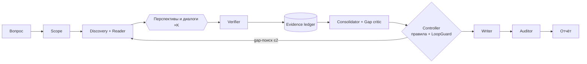

# introllm-research_helper

Мультиагентная система для работы с научной литературой:
- находит и разбирает статьи;
- отвечает на вопросы по ним;
- извлекает методы и результаты;
- оценивает силу доказательств;
- пишет обзор, где каждое утверждение ссылается на конкретный фрагмент статьи, а ограничения проговорены явно.

Рабочее название архитектуры — **SciStorm**. Это многоперспективное исследование в стиле [STORM](https://github.com/stanford-oval/storm), в котором каждое утверждение проверяется до того, как попасть в общий *evidence ledger*.

**Статус:** неделя 1 из 12 — разведка и baseline. Готовы каркас репозитория, схемы ledger, защита от зацикливания (`LoopGuard`) и CI. Агенты ещё не реализованы.

> Это исследовательский инструмент анализа литературы, а не источник медицинских, юридических или иных профессиональных рекомендаций.

## Идея

Обычный RAG находит релевантные статьи, но релевантная статья не обязательно подтверждает конкретное утверждение. Здесь:

1. Агенты-«спрашивающие» исследуют тему с нескольких перспектив: методолог, скептик, практик…
2. Агент-«эксперт» отвечает атомарными утверждениями со ссылками на фрагменты статей.
3. Verifier проверяет каждое утверждение до записи в ledger.
4. Обзор пишется только из проверенного, ссылки собирает код по ID.
5. Аудитор проверяет каждое предложение готового обзора.

Главный исследовательский вопрос: даёт ли этот подход более достоверные и полные обзоры, чем RAG и ванильный STORM, **при равном бюджете вычислений**.



Подробно — в [docs/design-doc.md](docs/design-doc.md).

## Быстрый старт

Нужен [uv](https://docs.astral.sh/uv/). Python 3.12 uv поставит сам. `make install` нужен и для хука против зацикливания: он запускается из `.venv` проекта.

```bash
make install
```

```bash
make check
```

```bash
cp .env.example .env
```

`make check` — ровно то, что запускает CI: ruff, проверка форматирования, mypy strict, pytest с покрытием ≥ 80%. Все команды: `make help`.

## Структура репозитория

```
introllm-research_helper/
├── AGENTS.md                 # правила для ИИ-агентов (главный файл)
├── CLAUDE.md                 # конфигурация Claude Code (импортирует AGENTS.md)
├── CONTRIBUTING.md           # стиль кода, библиотеки, обработка ошибок, тесты
├── Makefile                  # install / check / test / fmt
├── pyproject.toml            # зависимости (uv), ruff, mypy, pytest
├── .claude/
│   ├── settings.json         # разрешения и хуки Claude Code
│   └── hooks/loop_guard.py   # защита от зацикливания dev-агента
├── .github/
│   ├── workflows/ci.yml      # make check на каждый push и PR
│   └── pull_request_template.md
├── configs/
│   ├── budgets.yaml          # бюджеты прогона → LoopGuard
│   └── models.yaml           # роли → модели (пока не используется кодом)
├── docs/
│   ├── HISTORY.md            # история проекта: шаги и решения по этапам
│   ├── design-doc.md         # архитектура и экспериментальный дизайн
│   ├── context/              # краткий контекст, глоссарий, related work
│   ├── adr/                  # архитектурные решения
│   ├── tasks/                # задачи для агентов и людей (по шаблону)
│   ├── plans/                # планы по неделям
│   ├── reviews/              # ревью дизайна (MLSD)
│   └── labeling-guide.md     # гайд ручной разметки
├── src/research_helper/
│   ├── errors.py             # иерархия исключений
│   ├── config.py             # загрузка конфигов
│   ├── controller/           # FSM-контроллер, LoopGuard
│   ├── schemas/              # Pydantic-схемы ledger
│   ├── sources/              # S2, OpenAlex, arXiv + record/replay
│   ├── parsing/              # LaTeX, JATS, GROBID, Docling
│   ├── retrieval/            # BM25, dense, RRF, reranker
│   ├── agents/               # scope, discovery, asker, expert, critic, writer
│   ├── verification/         # verifier, аудитор, сверка чисел
│   ├── ledger/               # хранилище, консолидация, рубрика доказательности
│   ├── llm/                  # шлюз к LLM (litellm), трассы вызовов
│   ├── evaluation/           # метрики, судья, статистика
│   └── render/               # отчёт и список литературы
├── tests/
│   ├── unit/                 # быстрые тесты модулей
│   └── tooling/              # тесты инфраструктуры: хук, конфиги, контракты репо
├── baselines/                # B0–B5 (design-doc §8.3)
├── eval/golden/              # FreshSci golden set и шаблон
├── experiments/              # результаты прогонов (сырые данные — в .gitignore)
└── prompts/                  # версионированные промпты
```

Пустые пакеты в `src/` — это места для будущих задач. В `__init__.py` каждого описано, что туда кладётся.

## Документация

| Документ | Зачем |
|---|---|
| [docs/context/project-context.md](docs/context/project-context.md) | Проект на одной странице — начинать отсюда |
| [docs/design-doc.md](docs/design-doc.md) | Архитектура, метрики, эксперименты, риски |
| [docs/HISTORY.md](docs/HISTORY.md) | Что и почему решали на каждом этапе |
| [docs/adr/](docs/adr/) | Отдельные архитектурные решения |
| [docs/tasks/](docs/tasks/) | Текущие и будущие задачи |
| [docs/plans/week-01.md](docs/plans/week-01.md) | План текущей недели |
| [docs/context/glossary.md](docs/context/glossary.md) | Термины: claim, span, proposition, ledger… |

## Работа с ИИ-агентами

- **[AGENTS.md](AGENTS.md)** — единые правила для любых агентов (Claude Code, Codex, Cursor и др.): рабочий цикл, Definition of Done, правила остановки.
- **[CLAUDE.md](CLAUDE.md)** — то, что специфично для Claude Code. Импортирует AGENTS.md.
- **Задачи.** Агент работает по файлу задачи из [docs/tasks/](docs/tasks/), написанному по [шаблону](docs/tasks/_TEMPLATE.md): контекст, scope, контракты, критерии приёмки, стоп-условия.
- **Защита от зацикливания** — на трёх уровнях:
  - в коде продукта каждый цикл агентов идёт через `LoopGuard`;
  - в работе dev-агента хук `.claude/hooks/loop_guard.py` блокирует повторы одной и той же неудачной команды и откаты собственных правок. Запускается через `run_loop_guard.sh` из `.venv`; если окружения нет, хук пропускается, а не блокирует;
  - в CI стоят таймауты на тесты и на job.

## CI/CD

GitHub Actions ([.github/workflows/ci.yml](.github/workflows/ci.yml)) на каждый push в `main` и на каждый PR запускает `make check` на Python 3.12. В него входят и тесты хука: он запускается ровно той командой, что записана в `.claude/settings.json`.

**Защита `main`:** в настройках GitHub — правило для `main` с обязательной проверкой `check`. После этого изменения попадают в `main` только через PR с зелёным CI.

CD пока не нужен: деплоить нечего. Вернёмся к нему на этапе демо (неделя 12).

## Roadmap

| Недели | Этап | Статус |
|---|---|---|
| 1 | Разведка: related work, golden set, прогон STORM/PaperQA2, Gate 0 | в работе |
| 2 | Eval harness, независимый судья, B0/B1 | — |
| 3–4 | Discovery, Reader, ledger, рендер со ссылками по ID | — |
| 5–6 | Verifier, Expert, Auditor; B2 | — |
| 7–8 | Слой STORM: перспективы, диалоги, outline, writer; B3 | — |
| 9 | Consolidator, рубрика доказательности, gap critic, abstention | — |
| 10–11 | Финальные прогоны, ablations, статистика, error analysis | — |
| 12 | Демо, отчёт | — |

## Лицензия

Пока не выбрана.
